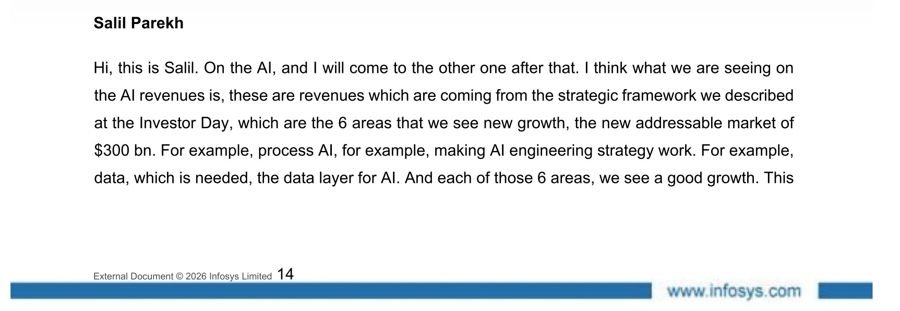
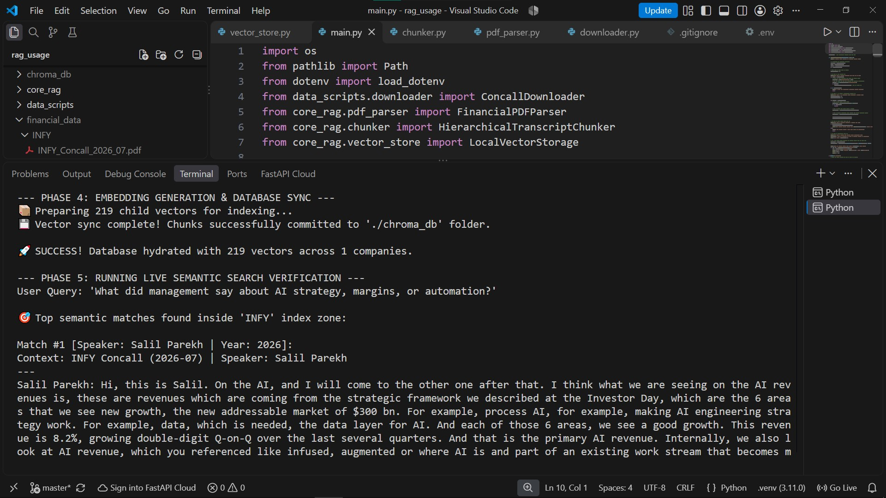

## 📊 Indian Financial Transcript RAG Analyzer

An enterprise-grade, localized Retrieval-Augmented Generation (RAG) pipeline designed to ingest, process, and analyze Earnings Call Transcripts from major Indian public companies (e.g., TCS, Infosys, Reliance).
This system leverages a syntactically-aware parent-child document architecture and a local vector database. It enables institutional-grade qualitative financial intelligence and cross-company moat synthesis.

### 🛠️ Tech Stack & Dependencies

* Language: Python 3.11+
* Core Orchestration & ETL: Python Standard Library (pathlib, re, uuid)
* Web Ingestion: requests + BeautifulSoup4 (Aggregator parsing via Screener.in)
* PDF Extraction: PyMuPDF (Layout-aware stream processing & metadata extraction)
* Local Embedding Architecture: sentence-transformers (BAAI/bge-small-en-v1.5 running locally on CPU)
* Vector Database Storage: ChromaDB (Persistent local in-memory spatial index cluster)

### 🏗️ Pipeline Architecture Layout

1. **Data Ingestion Layer**
*   **Web Ingestion:** Public Internet Sources `-->` Screener.in Discovery Portal (`requests` + `BeautifulSoup4`)
*   **Storage & Metadata Extraction:** Raw Binary Stream `-->` Property Inspection `-->` Temporal Filename Renaming (`<company>_Concall_<year>_<month>`)

2. **Document Processing & Splitting Layer**
*   **Plain-Text Layout Parsing:** Local PDF Files `-->` `pymupdf` Page-by-Page Chronological Text Stream
*   **Parent Chunk Segmentation:** Raw Text Strings `-->` Regex Speaker Detection `-->` Unique Parent UUID Assignment
*   **Child Chunk Generation:** Parent Content Blocks `-->` 150-word Sliding Window / 40-word Overlap `-->` Enriched Context Headers Added (Metadata)

3. **Vector Indexing Layer**
*   **Local Math Transformation:** Enriched Strings `-->` Local `BAAI/bge-small-en-v1.5` Tokenizer Model (384 Dimensions)
*   **Hydration:** Dense Arrays `-->` Persistent Local `ChromaDB` Index Cluster

### Proof of Working
1. Actual text in the PDF transcript, topic - AI.

2. Successful retrieval of child chunk (query in `main.py`)

`Query: What did management say about AI strategy, margins, or automation?`

### 🔮 Next Step

Integrate an LLM with the system to fetch parent chunks into its context window in response to a user query.